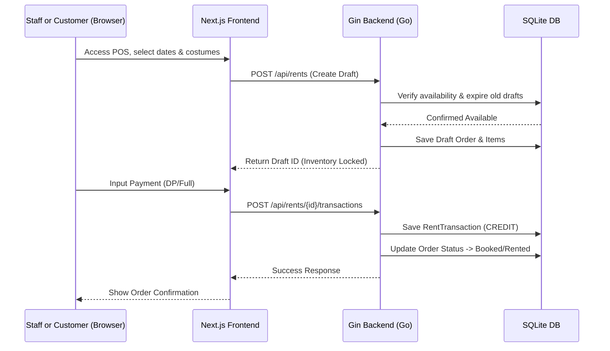
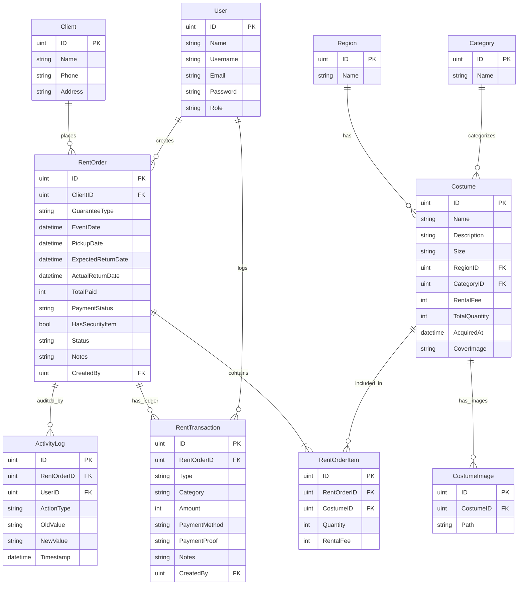

# Costume-Rent Architecture Document

This document outlines the technical design, database schema, API contracts, and engineering constraints of the Costume-Rent system.

## 1. Architecture Flow

## 2. Database Schema

| Table | Purpose |
| :--- | :--- |
| `User` | Internal staff/admin accounts with authentication credentials and roles. |
| `Client` | Customer profiles (Name, Phone, Address). |
| `Costume` | Master inventory list detailing rental fee, size, quantity, region, category, and images. |
| `Region` / `Category` | Lookups for categorizing costumes by style or region. |
| `CostumeImage` | Stores multiple image paths for a single costume. |
| `RentOrder` | The core rental event tracking specific dates, statuses, guarantee types, and the creator/client. |
| `RentOrderItem` | The specific costumes and their quantities attached to a parent `RentOrder`. |
| `RentTransaction` | The accounting ledger tracking all financial exchanges (payments, fees) and methods/proofs. |
| `ActivityLog` | Immutable audit trail of status changes or modifications (old/new values) performed by users. |

## 3. API Endpoints

| Method | Endpoint | Purpose |
| :--- | :--- | :--- |
| `GET` | `/api/costumes` | Fetch catalogue, with optional date parameters to filter for availability. |
| `POST` | `/api/rents` | Create a new `draft` order (temporarily locking inventory). |
| `PUT` | `/api/rents/:id/status` | Advance the order state (`draft` -> `booked` -> `rented` -> `returned`). |
| `POST` | `/api/rents/:id/transactions` | Log a payment, late fee, or damage fee to the order's ledger. |
| `GET` | `/api/rents` | Fetch all orders for the Dashboard, POS, or Rent History views. |
| `GET` | `/api/stats/dashboard` | Fetch high-level KPIs and upcoming events for the calendar. |

## 4. Design & Technical Constraints
*   **High-Level Technology:** 
    *   **Frontend:** Next.js 16 App Router, React 19, and Tailwind CSS 4.
    *   **Customer component boundary:** shadcn/ui components and marketplace tokens are scoped to customer route layouts (`/`, `/catalogue`, `/costumes/*`, `/cart`, `/checkout`, `/orders/*`, and `/account/*`).
    *   **Admin component boundary:** HeroUI v3 providers and components remain scoped to `/admin` and the staff login. Marketplace components must not import HeroUI, and admin components must not import marketplace shadcn components.
    *   **Backend:** Go (1.25), Gin Web Framework, GORM, SQLite.
    *   **Why:** This stack provides extreme speed, compile-time safety, and minimal operational overhead on the backend via Go and SQLite. The frontend leverages modern component libraries (HeroUI) for rapid, beautiful UI development without re-inventing basic accessible components.
*   **Typography Rules:** 
    *   Sans: `Geist Mono, ui-monospace, monospace`
    *   Serif: `serif`
    *   Mono: `JetBrains Mono, monospace`
