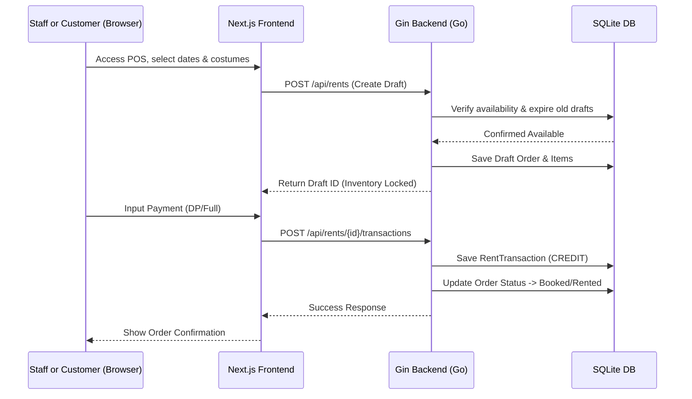
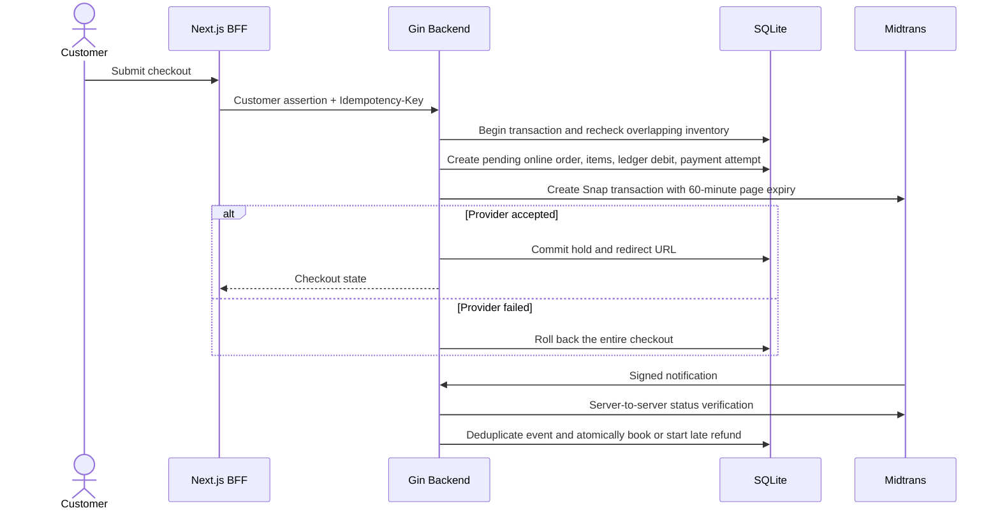
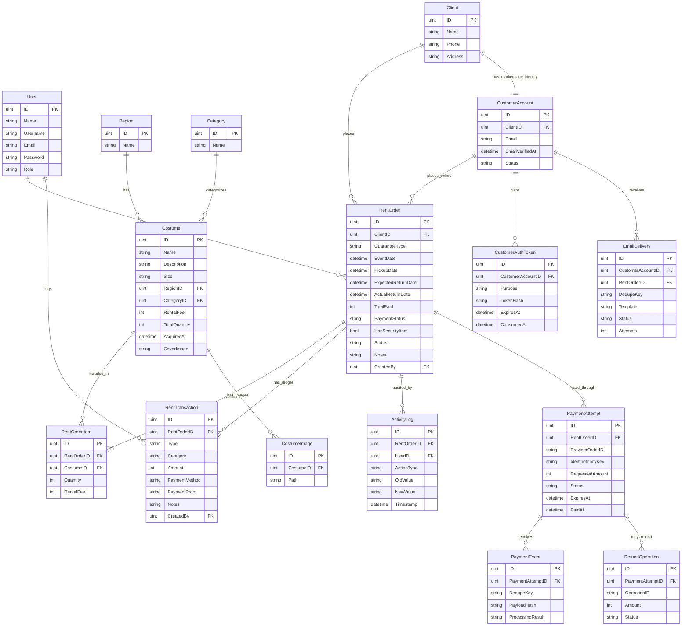

# Costume-Rent Architecture Document

This document outlines the technical design, database schema, API contracts, and engineering constraints of the Costume-Rent system.

## 1. Architecture Flow

### Marketplace booking and payment

The marketplace uses a separate security domain from staff. Next.js validates the
Auth.js customer session and sends a short-lived HS256 assertion with audience
`costume-rent-marketplace-api` to Go. The assertion is signed with
`MARKETPLACE_ASSERTION_SECRET`; it never reaches the browser. Go resolves the
normalized email to a Go-owned `CustomerAccount`, linked one-to-one to the
operational `Client` profile.

Email/password registration, verification, login, password reset, and verification
resend are exposed for the Auth.js credentials provider under
`/api/marketplace/auth/*`. Verification/reset tokens are random, one-time,
SHA-256 hashes at rest, and expire after 24 hours/one hour respectively. Google
sessions resolve through the signed assertion path. SMTP delivery metadata is
recorded without persisting raw authentication tokens.

An unexpired online `pending` order consumes availability. Queries exclude it as
soon as `expires_at` is reached, even before the minute-based cleanup worker
persists `cancelled`. Only a verified `settlement`, or an accepted `capture`,
creates the unique marketplace payment ledger credit and transitions the order
to `booked`.

## 2. Database Schema

| Table | Purpose |
| :--- | :--- |
| `User` | Internal staff/admin accounts with authentication credentials and roles. |
| `Client` | Customer profiles (Name, Phone, Address). |
| `Costume` | Master inventory list detailing rental fee, size, quantity, region, category, and images. |
| `Region` / `Category` | Lookups for categorizing costumes by style or region. |
| `CostumeImage` | Stores multiple image paths for a single costume. |
| `RentOrder` | The core rental event tracking specific dates, statuses, guarantee types, and the creator/client. |
| `RentOrderItem` | The specific costumes and their quantities attached to a parent `RentOrder`. |
| `RentTransaction` | The accounting ledger tracking all financial exchanges (payments, fees) and methods/proofs. |
| `ActivityLog` | Immutable audit trail of status changes or modifications (old/new values) performed by users. |
| `CustomerAccount` | Marketplace identity and verification state, separate from staff `User` credentials and linked to one `Client`. |
| `PaymentAttempt` | One Midtrans payment attempt, including the hold-aligned expiry and provider-safe state. |
| `PaymentEvent` | Hashed, deduplicated processing record for provider notifications; raw PII-bearing payloads are not stored. |
| `RefundOperation` | Idempotent late-payment or staff-authorized refund operation and recovery state. |
| `MarketplaceAuditLog` | Customer/system/staff audit events that do not assume a staff `User` actor. |
| `CustomerAuthToken` | Hashed, expiring, one-time email verification and password reset token. |
| `EmailDelivery` | Deduplicated transactional email outbox/delivery result for booking, payment, refund, cancellation, pickup, and return messages. |

## 3. API Endpoints

| Method | Endpoint | Purpose |
| :--- | :--- | :--- |
| `GET` | `/api/costumes` | Fetch catalogue, with optional date parameters to filter for availability. |
| `POST` | `/api/rents` | Create a new `draft` order (temporarily locking inventory). |
| `PUT` | `/api/rents/:id/status` | Advance the order state (`draft` -> `booked` -> `rented` -> `returned`). |
| `POST` | `/api/rents/:id/transactions` | Log a payment, late fee, or damage fee to the order's ledger. |
| `GET` | `/api/rents` | Fetch all orders for the Dashboard, POS, or Rent History views. |
| `GET` | `/api/stats/dashboard` | Fetch high-level KPIs and upcoming events for the calendar. |
| `GET` | `/api/marketplace/costumes[/:id]` | Public marketplace-safe catalogue; never returns buy price or exact inventory. |
| `POST` | `/api/marketplace/checkouts` | Create an atomic 60-minute hold and Midtrans payment attempt. |
| `GET/DELETE` | `/api/marketplace/checkouts/:id` | Resume or abandon an owned checkout. |
| `GET` | `/api/marketplace/orders[/:id]` | List or read customer-owned online orders. |
| `POST` | `/api/marketplace/orders/:id/cancel` | Cancel a booked online order under the downpayment-forfeiture policy. |
| `POST` | `/api/payments/midtrans/webhook` | Verify signature and provider status, then process an idempotent state change. |
| `PUT` | `/api/rents/:id/delivery` | Staff confirms or declines an online delivery request. |
| `POST` | `/api/rents/:id/refunds` | Admin-only, idempotent exceptional refund. |
| `POST` | `/api/payment-attempts/:id/reconcile` | Admin-only provider reconciliation/recovery. |
| `POST` | `/api/marketplace/auth/register` | Create an unverified email/password customer account. |
| `POST` | `/api/marketplace/auth/login` | Validate a verified credentials account for Auth.js. |
| `POST` | `/api/marketplace/auth/verify-email` | Consume a one-time email verification token. |
| `POST` | `/api/marketplace/auth/forgot-password` | Issue password-reset email without account enumeration. |
| `POST` | `/api/marketplace/auth/reset-password` | Consume a one-time reset token and replace the password hash. |

## 4. Design & Technical Constraints
*   **High-Level Technology:** 
    *   **Frontend:** Next.js 16 App Router, React 19, and Tailwind CSS 4.
    *   **Customer component boundary:** shadcn/ui components and marketplace tokens are scoped to customer route layouts (`/`, `/catalogue`, `/costumes/*`, `/cart`, `/checkout`, `/orders/*`, and `/account/*`).
    *   **Admin component boundary:** HeroUI v3 providers and components remain scoped to `/admin` and the staff login. Marketplace components must not import HeroUI, and admin components must not import marketplace shadcn components.
    *   **Backend:** Go (1.25), Gin Web Framework, GORM, SQLite.
    *   **Payments:** Midtrans Snap hosted payment. `MIDTRANS_SERVER_KEY` remains backend-only; `MIDTRANS_ENVIRONMENT` selects sandbox or production.
    *   **Consistency:** A single SQLite writer is the deployment boundary. Checkout availability checks and hold writes run in one database transaction; provider creation failure rolls it back.
    *   **Authentication:** Staff JWTs use `JWT_SECRET`. Marketplace assertions use the independent `MARKETPLACE_ASSERTION_SECRET` and a fixed audience.
    *   **Rollout:** In production, checkout creation remains unavailable until `MARKETPLACE_CHECKOUT_ENABLED=true`; public catalogue and authentication can be enabled first.
    *   **Email:** SMTP delivery uses `SMTP_HOST`, `SMTP_PORT`, `SMTP_USERNAME`, `SMTP_PASSWORD`, and `SMTP_FROM`. Booking-state email is queued transactionally and retried without rolling back valid payment/order state.
    *   **Why:** This stack provides extreme speed, compile-time safety, and minimal operational overhead on the backend via Go and SQLite. The frontend leverages modern component libraries (HeroUI) for rapid, beautiful UI development without re-inventing basic accessible components.
*   **Typography Rules:** 
    *   Sans: `Geist Mono, ui-monospace, monospace`
    *   Serif: `serif`
    *   Mono: `JetBrains Mono, monospace`
