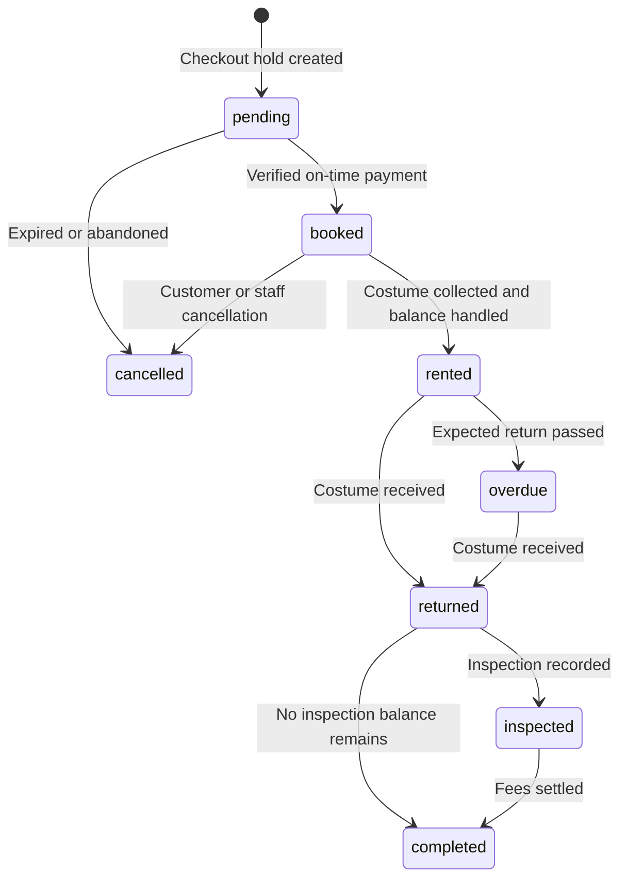
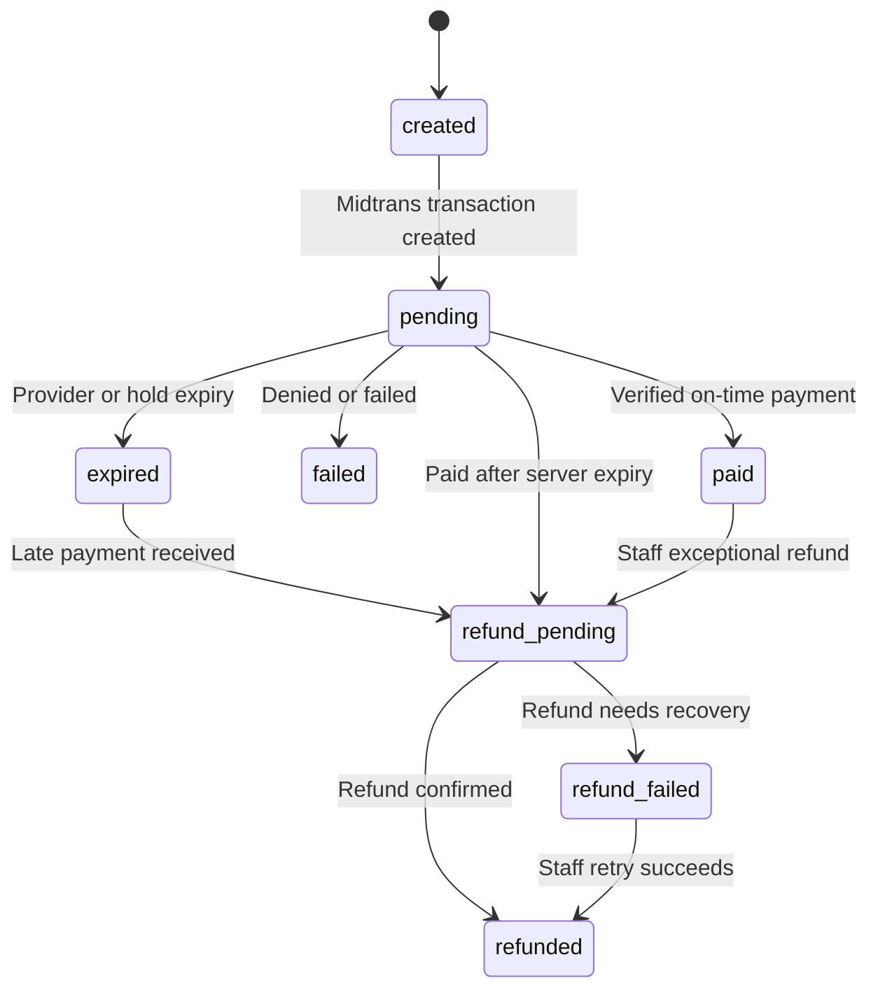
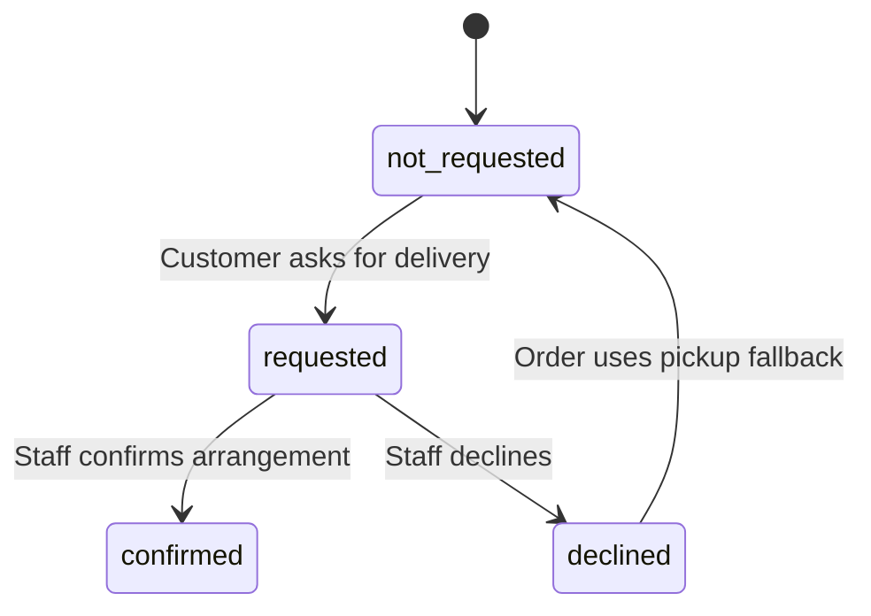
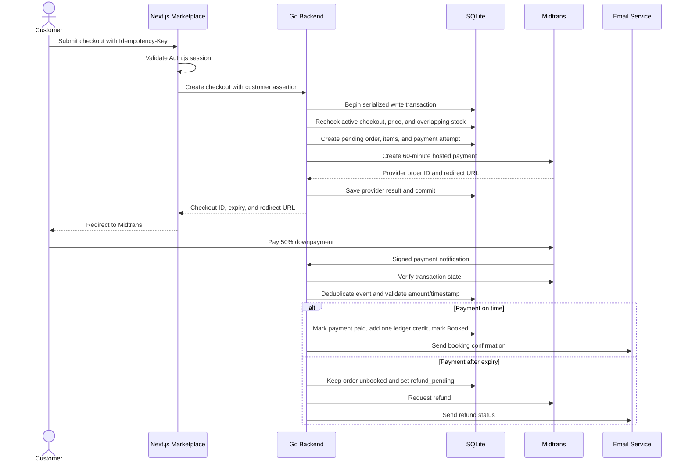

# Client Marketplace Product Requirements Document

## 1. Document Status

| Field | Value |
| :--- | :--- |
| Product | Costume-Rent Client Marketplace |
| Status | Approved for implementation planning |
| Primary language | Indonesian (`id-ID`) |
| Currency | Indonesian Rupiah (`IDR`) |
| Business timezone | Asia/Jakarta |
| Marketplace frontend | Existing Next.js application, customer route group |
| Admin frontend | Existing Next.js application under `/admin` |
| Backend | Go, Gin, GORM |
| Database | SQLite, single backend instance |

This document defines the MVP customer marketplace. It is the source of truth for customer-facing booking, payment, fulfillment, cancellation, authentication, and inventory-reservation behavior.

---

## 2. Overview

### Purpose

Provide a mobile-first marketplace where customers can browse costumes, check availability for an Event Date, reserve available quantities, pay the required downpayment through Midtrans, and manage their bookings without staff creating the initial order.

### Problem

Customers currently depend on staff-assisted POS entry or an in-person visit. This limits discovery, creates avoidable staff work, and does not let customers confidently secure stock outside operating hours.

### Primary goal

Allow a customer to complete a valid, paid costume booking online while preserving the inventory, payment-ledger, and operational workflows already used by staff.

### Product principles

- Browsing is public; authentication is required only when the customer proceeds to checkout.
- The Event Date is the customer's primary date input.
- Inventory is never reserved merely because an item is in a cart.
- The backend is authoritative for availability, price, expiry, ownership, and payment state.
- A browser redirect from Midtrans is never proof of payment.
- Customer accounts and staff accounts are separate security domains.
- Store pickup is the guaranteed fulfillment method. Delivery is a request until staff confirms it.

---

## 3. Goals and Success Criteria

### MVP goals

- Publish an SEO-friendly public costume catalogue.
- Show date-aware availability without exposing internal inventory or accounting data.
- Support Google and verified email/password customer authentication.
- Preserve the customer's cart across authentication.
- Create an atomic 60-minute inventory hold at checkout.
- Collect a 50% downpayment through a Midtrans-hosted payment page.
- Convert the hold to a Booked order only after authoritative payment verification.
- Give customers an order history and a clear cancellation flow.
- Keep online orders compatible with the existing staff rental lifecycle and ledger.

### Success metrics

| Metric | MVP target |
| :--- | :--- |
| Payment-start-to-Booked conversion | At least 80% |
| Bookings completed without staff creating the order | At least 80% |
| Inventory oversells or double-bookings | 0 |
| Duplicate ledger credits from webhook replay | 0 |
| Expired holds released without staff action | 100% |
| Failed late-payment refunds surfaced to staff | Within 5 minutes |
| Mobile LCP at p75 | At most 2.5 seconds |
| Mobile INP at p75 | At most 200 ms |
| CLS at p75 | At most 0.1 |

Metric denominators and failure reasons must be recorded so abandonment, payment failure, stock conflict, and technical failure can be distinguished.

---

## 4. Users and Roles

### Visitor

- Browse and search the public catalogue.
- Filter by region, category, size, and Event Date.
- View costume details and marketplace-safe availability.
- Add items to a local cart.
- Cannot create an inventory hold or view an order.

### Customer

- Has authenticated through Google or verified email/password.
- Owns one `CustomerAccount` linked to one business `Client` profile.
- Can create, resume, or abandon one active unpaid checkout.
- Can view only their own checkouts and orders.
- Can cancel their own paid booking after accepting the forfeiture notice.

### Staff or admin

- Continues using the existing `/admin` application and staff `User` account.
- Can inspect online orders, payment attempts, delivery requests, and recovery failures.
- Can confirm or decline delivery requests.
- Can issue an exceptional refund through an audited staff-only action.
- Cannot access a customer account merely by using a staff-facing public endpoint.

---

## 5. Domain and Policy Decisions

### Rental period

- A cart and order have exactly one Event Date.
- Customers do not choose arbitrary pickup and return dates in MVP.
- Pickup and expected return dates are derived from the active admin settings:
  - Pickup: Event Date minus `pickup_days_before`, default D−2.
  - Return: Event Date plus `return_days_after`, default D+1.
- The Rental Fee is flat for this standard Rental Period and is not a daily rate.
- The checkout summary must show all three dates before payment.

### Downpayment

- A booking requires exactly 50% of the rental-item total.
- The amount is rounded up to the nearest whole rupiah: `ceil(total / 2)`.
- Delivery fees are excluded from the marketplace downpayment.
- The downpayment is non-refundable when the customer voluntarily cancels.
- Staff may grant an exceptional refund through a separate audited operation.

### Cart and inventory hold

- Adding an item to a cart does not reserve inventory.
- The server creates a hold only after:
  1. The customer is authenticated and verified.
  2. Checkout data passes validation.
  3. Prices and overlapping inventory are revalidated.
  4. A Midtrans payment attempt can be created.
- The hold lasts 60 minutes.
- The server-provided `expires_at` value is authoritative; the UI countdown is informational.
- An unexpired online `pending` order consumes availability.
- An expired hold never consumes availability, even if a cleanup worker has not yet updated its stored status.

### Anti-abuse policy

- A customer can have only one active unpaid checkout.
- Repeating the same checkout request with the same idempotency key returns the original result.
- A different checkout is rejected while another active checkout exists; the customer must resume or abandon it.
- The default online quantity cap is two units of a costume per order.
- Checkout creation is limited by customer account and IP address.
- Repeated suspicious attempts trigger a bot challenge.

### Payment timeliness

- Midtrans transaction expiry must match the server hold expiry.
- A payment is on time when the verified provider payment timestamp is at or before `expires_at`.
- Webhook delivery latency does not make an otherwise on-time payment late.
- A payment made after expiry never revives the order and must enter the refund workflow.
- If an automatic refund fails, the order remains unbooked and staff receives a recovery alert.

### Cancellation

- A customer may cancel a Booked online order immediately.
- Before confirmation, the UI must state that the downpayment will be forfeited.
- Cancellation releases inventory immediately.
- The retained downpayment and cancellation adjustment must remain represented in the immutable payment ledger.
- Exceptional refunds are staff-only, idempotent, and audited.

### Fulfillment

- `pickup` is the default and guaranteed fulfillment type.
- A customer may submit a `delivery_request` with address and contact details.
- The 50% downpayment books the costumes regardless of delivery-request outcome.
- Until staff confirms delivery, the order remains fulfillable through store pickup.
- Declining delivery must not cancel the booking or automatically refund the downpayment.
- Any delivery fee is arranged and recorded separately by staff.

---

## 6. Scope

### Included in MVP

- Public landing and catalogue pages.
- Search and filters.
- Costume detail pages with images and date-aware availability.
- One Event Date per cart.
- Local cart persisted across refresh and authentication.
- Google login.
- Verified email/password registration, login, email verification, and password reset.
- Checkout review and terms acceptance.
- Atomic stock hold with countdown and resume/abandon controls.
- Midtrans hosted redirect payment.
- Payment-processing return page.
- Customer order history and detail.
- Customer cancellation with downpayment forfeiture.
- Pickup and delivery-request selection.
- Transactional email.
- Staff visibility for delivery requests and payment/refund recovery.

### Explicitly out of scope

- Guest checkout.
- Customer-selectable full payment.
- Arbitrary pickup or return dates.
- Dynamic delivery pricing or courier integration.
- Automated WhatsApp messaging.
- Reviews, ratings, wishlists, and recommendations.
- Loyalty programs or promotion codes.
- Multi-currency or multilingual content beyond Indonesian MVP copy.
- PostgreSQL migration.
- Object storage migration.
- Multiple backend replicas or horizontal scaling.
- Per-physical-item barcodes or asset tracking.

---

## 7. Customer Experience

### Primary booking flow

1. A visitor opens the marketplace and browses costumes.
2. The visitor selects an Event Date.
3. The catalogue refreshes marketplace-safe availability for that date.
4. The visitor adds one or more available costumes to the cart.
5. The visitor opens checkout and is prompted to authenticate.
6. After authentication, the cart is restored and revalidated.
7. The customer supplies or confirms name, phone number, and fulfillment details.
8. The server calculates pickup, return, total Rental Fee, and 50% downpayment.
9. The customer reviews:
   - Items and quantities.
   - Event, pickup, and return dates.
   - Downpayment amount.
   - Non-refundable cancellation policy.
   - Pickup fallback for a delivery request.
   - Hold duration and terms version.
10. Submitting checkout atomically creates the hold and Midtrans payment attempt.
11. The customer is redirected to Midtrans and sees the remaining hold time.
12. Midtrans returns the customer to an order-processing page.
13. The page polls the server; it does not infer success from URL parameters.
14. A verified webhook changes the order to Booked and creates one ledger payment credit.
15. The customer receives a booking email and can view the order in their account.

### Authentication interruption

- Cart contents and Event Date survive Google or email authentication.
- Availability and price are always rechecked after authentication.
- If an item is no longer available, the UI identifies the affected item and returns the customer to the cart without creating a hold.

### Existing active checkout

- The customer is shown the existing checkout, its countdown, and its payment link.
- The customer may resume payment or explicitly abandon the checkout.
- Abandoning releases stock and expires the provider payment attempt.
- A late provider payment against an abandoned attempt follows the refund policy.

### Hold expiry

- The order becomes Cancelled/expired and stock is immediately considered available.
- The processing page and account history display that payment time expired.
- The customer may return to the cart and start a new availability check.
- A new checkout requires a new idempotency key and payment attempt.

### Payment result

- `pending`: show processing and continue bounded polling.
- `paid` on time: show Booked confirmation.
- `failed`, `denied`, `cancelled`, or `expired`: release the hold and offer a retry from the cart.
- `refund_pending`: explain that a late payment is being returned.
- `refunded`: show refund confirmation.
- `refund_failed`: show a support message while staff handles recovery; never show Booked.

---

## 8. Functional Requirements

### Catalogue

- Catalogue pages must be server-renderable and indexable.
- Search supports costume name.
- Filters support region, category, size, and Event Date.
- Costume detail includes description, size, category, region, Rental Fee, and public images.
- Availability responses expose only:
  - Whether the costume is available.
  - The maximum quantity the customer may add, capped by the online order limit.
- Public responses must not include buy price, acquisition date, exact total inventory, internal notes, or staff activity.

### Cart

- The cart is stored client-side before authentication.
- All lines share one Event Date.
- Changing the Event Date revalidates every line.
- Quantity cannot exceed the public maximum or default online cap.
- The cart shows estimated pickup and return dates.
- Cart totals are estimates until server checkout validation.

### Customer authentication

- Google OAuth and email/password are customer-only authentication methods.
- Email addresses are normalized and unique.
- Email/password checkout requires verified email ownership.
- Verification and reset tokens are one-time, stored as hashes, expire, and record consumption.
- Customer session cookies are encrypted, HttpOnly, Secure in production, and SameSite.
- Customer sessions cannot authorize staff APIs.
- Staff JWTs cannot authorize customer-owned order APIs.

### Checkout

- Checkout creation requires an `Idempotency-Key`.
- The server rejects an empty cart, past Event Date, invalid quantity, unavailable item, altered price, invalid fulfillment data, or unverified customer.
- Delivery request requires a valid delivery address and phone number.
- The accepted policy/terms version and timestamp are recorded.
- Order, items, fee snapshots, hold, and payment attempt are created atomically.
- If Midtrans transaction creation fails, no persistent stock hold may remain.

### Orders

- Customers can list and view only orders linked to their `CustomerAccount`.
- Order detail shows lifecycle status, payment status, dates, items, fulfillment, delivery-request status, and ledger summary.
- Customers cannot edit item quantities or Event Date after payment begins.
- Customer cancellation is available only for eligible Booked online orders.

### Staff operations

- Admin can filter orders by `order_source = online`.
- Admin can see payment attempt and refund status without seeing provider secrets.
- Admin can confirm or decline delivery requests.
- Admin can retry eligible failed refund/reconciliation operations idempotently.
- Admin can perform exceptional refunds with reason, amount validation, confirmation, and audit logging.

### Email

MVP transactional messages:

- Verify email address.
- Reset password.
- Payment succeeded and booking confirmed.
- Payment failed or expired.
- Late payment refund started/completed.
- Booking cancelled and downpayment forfeited.
- Pickup reminder.
- Expected return reminder.

Email delivery failure must not roll back an otherwise valid booking. It must be logged for retry or staff visibility.

---

## 9. State Models

### Rental order lifecycle



The existing operational lifecycle remains authoritative. “Awaiting payment” is the customer-facing label for `pending`.

### Payment attempt lifecycle



### Delivery-request lifecycle



Order, payment, and delivery status must remain separate fields.

---

## 10. System Architecture

### Technology

| Layer | Technology and decision |
| :--- | :--- |
| Customer frontend | Existing Next.js 16 App Router and React 19 application |
| Customer components | shadcn/ui, isolated to customer route layouts |
| Admin components | Existing HeroUI implementation under `/admin` |
| Styling | Tailwind CSS 4 with separate customer tokens |
| Customer sessions | Auth.js |
| Backend | Existing Go 1.25, Gin, and GORM service |
| Database | Existing SQLite database, single writer/backend deployment |
| Payments | Midtrans hosted redirect and server webhook |
| Email | Provider-neutral email service with an SMTP implementation |
| Deployment | One Docker host behind one HTTPS origin |

shadcn/ui is an intentional customer-surface exception to the project’s HeroUI-first convention. Components and theme providers from the two systems must not be imported across their route boundaries.

### Authentication and API flow

- The browser communicates with same-origin Next.js marketplace endpoints.
- Next.js validates the Auth.js customer session.
- For protected customer API requests, Next.js sends a short-lived internal assertion to Go.
- The internal assertion contains customer identity, audience, issue time, and expiry.
- The browser never receives the internal assertion.
- Go verifies the assertion using a dedicated marketplace secret/key that is separate from the staff JWT secret.
- Google sign-in and credential sign-in both resolve to a Go-owned `CustomerAccount`.

### Booking sequence



---

## 11. Data Model

### New entities and extensions

```mermaid
erDiagram
    Client ||--|| CustomerAccount : "has marketplace identity"
    CustomerAccount ||--o{ CustomerAuthToken : "owns"
    CustomerAccount ||--o{ RentOrder : "places"
    RentOrder ||--|{ RentOrderItem : "contains"
    Costume ||--o{ RentOrderItem : "reserved by"
    RentOrder ||--o{ RentTransaction : "has ledger"
    RentOrder ||--o{ PaymentAttempt : "has payment attempts"
    PaymentAttempt ||--o{ PaymentEvent : "receives events"
    User ||--o{ ActivityLog : "performs staff action"

    CustomerAccount {
        uint ID PK
        uint ClientID FK UK
        string Email UK
        datetime EmailVerifiedAt
        string PasswordHash
        string GoogleSubject UK
        string Status
        datetime LastLoginAt
    }

    CustomerAuthToken {
        uint ID PK
        uint CustomerAccountID FK
        string Purpose
        string TokenHash UK
        datetime ExpiresAt
        datetime ConsumedAt
    }

    RentOrder {
        uint ID PK
        uint ClientID FK
        uint CustomerAccountID FK
        datetime EventDate
        datetime PickupDate
        datetime ExpectedReturnDate
        datetime ExpiresAt
        string Status
        string OrderSource
        string FulfillmentType
        string DeliveryRequestStatus
        string ShippingAddress
        string TermsVersion
        datetime TermsAcceptedAt
    }

    PaymentAttempt {
        uint ID PK
        uint RentOrderID FK
        string Provider
        string ProviderOrderID UK
        string ProviderTransactionID
        string IdempotencyKey UK
        int RequestedAmount
        string Status
        string PaymentType
        string RedirectURL
        datetime ExpiresAt
        datetime PaidAt
        datetime RefundedAt
        string FailureReason
    }

    PaymentEvent {
        uint ID PK
        uint PaymentAttemptID FK
        string DedupeKey UK
        string PayloadHash
        string ProcessingResult
        datetime ReceivedAt
        datetime ProcessedAt
    }
```

### Data rules

- `CustomerAccount.Email` is normalized before uniqueness checks.
- `Client` remains the business/customer profile; marketplace credentials are never stored on `Client`.
- `User` remains staff-only.
- `RentOrder.OrderSource` is `online` for marketplace orders and `offline` for existing staff-created orders.
- Online `pending` orders require `ExpiresAt`.
- Each order item stores the Rental Fee snapshot used at checkout.
- Provider secrets and full raw payment credentials are never stored.
- Webhook payload storage must exclude or redact unnecessary personal or secret data.
- Existing records must be migrated without changing their current staff workflow.

---

## 12. API Contract

Browser-facing customer endpoints are served through the Next.js backend-for-frontend. Go endpoints may use an internal prefix, but the following public contract is stable.

### Public catalogue

| Method | Endpoint | Authentication | Purpose |
| :--- | :--- | :--- | :--- |
| `GET` | `/api/marketplace/costumes` | Public | Search/filter marketplace-safe catalogue |
| `GET` | `/api/marketplace/costumes/:id` | Public | Fetch marketplace-safe costume detail |

Catalogue parameters may include `search`, `region_id`, `category_id`, `size`, `event_date`, `page`, and `limit`.

### Checkout and orders

| Method | Endpoint | Authentication | Purpose |
| :--- | :--- | :--- | :--- |
| `POST` | `/api/marketplace/checkouts` | Verified customer | Validate cart, hold stock, create payment |
| `GET` | `/api/marketplace/checkouts/:id` | Owner | Resume checkout and read expiry/payment state |
| `DELETE` | `/api/marketplace/checkouts/:id` | Owner | Abandon checkout and release hold |
| `GET` | `/api/marketplace/orders` | Customer | List the customer’s orders |
| `GET` | `/api/marketplace/orders/:id` | Owner | Fetch customer-safe order detail |
| `POST` | `/api/marketplace/orders/:id/cancel` | Owner | Cancel eligible Booked order and forfeit DP |

### Payment integration

| Method | Endpoint | Authentication | Purpose |
| :--- | :--- | :--- | :--- |
| `POST` | `/api/payments/midtrans/webhook` | Provider signature | Process authoritative payment notification |

### Admin-only additions

| Method | Endpoint | Purpose |
| :--- | :--- | :--- |
| `PUT` | `/api/rents/:id/delivery` | Confirm or decline delivery request |
| `POST` | `/api/rents/:id/refunds` | Create exceptional audited refund |
| `POST` | `/api/payment-attempts/:id/reconcile` | Retry verification or failed recovery |

### Error behavior

- Use stable machine-readable error codes.
- Return `409 Conflict` for stock conflict, duplicate active checkout, or invalid state transition.
- Return `401 Unauthorized` for missing/expired customer session.
- Return `403 Forbidden` for valid identity without order ownership.
- Return `422 Unprocessable Entity` for invalid checkout data.
- Never reveal whether another customer owns a requested order ID.

---

## 13. Payment and Webhook Requirements

- Midtrans Server Key is backend-only.
- The server generates a unique provider order ID for every payment attempt.
- Checkout creation and provider calls use idempotency controls.
- Webhook verification includes signature, provider order ID, amount, transaction state, and a server-to-server status check.
- Accepted success states must be explicitly mapped; capture must also meet the required fraud status.
- Duplicate and out-of-order events must not duplicate a ledger payment, order transition, refund, or email.
- A paid order receives exactly one `CREDIT/PAYMENT` ledger transaction for the downpayment.
- Browser callbacks and query parameters are display/navigation inputs only.
- Refund requests and retries use a unique operation identifier.
- Refund failure never changes the rental order to Booked.

---

## 14. Security and Privacy

### Required controls

- Remove or protect public staff registration. No unauthenticated endpoint may create an admin or staff user.
- Use separate secrets/audiences for staff JWTs and marketplace customer assertions.
- Enforce customer ownership in the backend for every protected checkout/order operation.
- Protect session-authenticated mutations against CSRF.
- Rate-limit registration, login, reset, checkout, cancellation, and webhook endpoints separately.
- Hash passwords using the project’s secure password hashing implementation.
- Hash email verification and password-reset tokens at rest.
- Validate uploaded and provider-returned URLs before rendering.
- Apply request-body and field-size limits.
- Use HTTPS in production.
- Encrypt off-host backups and restrict access to database/media volumes.
- Avoid logging passwords, session tokens, provider keys, reset tokens, or full webhook payloads containing unnecessary PII.

### Personal data

Marketplace PII includes name, email, phone, address, authentication identifiers, and order history.

- Collect only data required for authentication, contact, booking, and requested delivery.
- Restrict staff access to operational need.
- Define retention and account-deactivation procedures before production launch.
- Payment-card data must remain on Midtrans-hosted surfaces and must not pass through application servers.

---

## 15. Frontend and Design Requirements

### Route isolation

Customer routes:

- `/`
- `/catalogue`
- `/costumes/[id]`
- `/cart`
- `/checkout`
- `/orders/[id]`
- `/account/orders`
- Customer authentication and recovery routes

Admin remains under `/admin`. The legacy `/catalogue` redirect to `/admin/catalogue` must be removed when the customer catalogue launches.

### Component systems

- Customer routes use shadcn/ui components owned by the project.
- Admin routes continue using HeroUI.
- Customer and admin layouts have separate providers and theme tokens.
- Customer code must not import HeroUI.
- Admin code must not import marketplace shadcn components.
- Shared business utilities and API types may be reused when they do not depend on either visual system.

### Customer design direction

- Mobile-first, image-led, and suitable for a local costume-rental business.
- Indonesian copy with concise, concrete labels.
- Use the existing business identity/logo where available.
- Default typography follows the current Inter-based product typography; monospaced text is reserved for identifiers and countdowns.
- Avoid presenting the Rental Fee as “per day.”
- Dynamic amounts and countdowns use tabular numerals.
- Minimum interactive hit area is 40×40 px.
- Headings balance cleanly; body copy avoids orphaned words.
- Motion communicates cart, loading, payment, and status changes and respects reduced-motion preferences.
- Loading, empty, expired, unavailable, processing, refund, and error states are required.

### Accessibility

- Target WCAG 2.2 AA.
- All workflows must be keyboard-operable.
- Forms require programmatic labels and specific validation messages.
- Status must not be conveyed by color alone.
- Countdown expiry must be announced without continuously overwhelming assistive technology.
- Payment and cancellation confirmations require a clear heading, summary, and recovery action.

---

## 16. Localization

- UI language is Indonesian for MVP.
- Dates are stored in UTC-compatible timestamps and displayed in Asia/Jakarta.
- Event, pickup, and return are business dates; calculations must not drift due to browser timezone.
- Currency is integer IDR and formatted using `id-ID`.
- Customer emails use Indonesian templates.
- English fallback copy is not required for MVP.

---

## 17. Deployment and Operations

### MVP topology

- Run Next.js and one Go backend on one Docker host.
- Expose them behind one HTTPS origin/reverse proxy.
- Persist SQLite data and uploaded media in named volumes.
- Configure SQLite foreign keys, WAL mode, a busy timeout, and serialized reservation writes.
- Do not run multiple Go replicas against the SQLite file.

### Backups and recovery

- Create an encrypted off-host database backup at least daily.
- Back up marketplace-required media or document its independent recovery process.
- Retain a documented backup rotation.
- Perform and record a restore test before production launch and periodically afterward.

### Background work

- Expire and reconcile pending holds on a recurring schedule.
- Availability queries must independently ignore expired holds.
- Retry eligible email and refund operations with bounded backoff.
- Send staff alerts for `refund_failed`, persistently stuck payment attempts, and worker failures.

### Observability

- Emit structured logs with request, customer, order, checkout, payment-attempt, and provider-order correlation IDs where appropriate.
- Record checkout outcomes, payment transitions, webhook deduplication, refunds, expiration, and reconciliation.
- Never put secrets or unnecessary PII in metrics or logs.
- Provide a health endpoint that verifies application readiness without exposing configuration.

---

## 18. Non-Functional Requirements

### Performance

- Server-render public catalogue and costume metadata for SEO.
- Keep date-specific availability dynamic and uncached beyond a safely short interval.
- Optimize marketplace images and prevent layout shift.
- Paginate catalogue and order history.
- Avoid loading admin-only HeroUI code in the customer route bundle.

### Availability and consistency

- The backend and SQLite database are the system of record.
- Reservation creation is strongly consistent within the single backend instance.
- Payment processing is eventually consistent but idempotent.
- A cleanup worker delay must not create false stock unavailability.

### Scalability boundary

The MVP is intentionally a single-backend, SQLite deployment. It must not be described as horizontally scalable or stateless. Moving to multiple backend replicas requires a relational database and shared/object media storage and is a future architecture change.

---

## 19. Acceptance Criteria and Test Strategy

### Backend unit and integration tests

- Event Date produces the configured pickup and return dates.
- Odd totals round the 50% downpayment upward.
- Public availability counts overlapping Booked, Rented, Overdue, and unexpired Pending quantities.
- Expired Pending orders do not consume availability before cleanup runs.
- Two concurrent checkout requests cannot reserve more than available stock.
- Checkout creation is all-or-nothing when Midtrans creation fails.
- Same idempotency key returns the same checkout/payment attempt.
- A customer cannot create a second active unpaid checkout.
- Abandoning a checkout releases availability.
- Customer ownership is enforced for list, detail, abandon, and cancellation operations.
- A customer assertion cannot authorize a staff route and a staff JWT cannot impersonate a customer.

### Payment tests

- Valid on-time payment produces one Booked transition and one ledger credit.
- Invalid signature, amount mismatch, or unknown provider order ID is rejected.
- Duplicate webhook events are harmless.
- Out-of-order provider events cannot move payment or order state backward.
- Payment after expiry starts refund and never books the order.
- Delayed webhook for a provider-timestamped on-time payment still books the order.
- Failed refund becomes `refund_failed` and can be retried once without duplicate refunds.
- Browser return without webhook remains Processing.

### Frontend tests

- Cart supports multiple costumes with one Event Date.
- Changing Event Date revalidates all lines.
- Cart survives login and returns to checkout.
- Unavailable items are identified after revalidation.
- Internal catalogue fields never appear in public API fixtures or UI.
- Countdown uses server expiry and handles local clock drift.
- Cancellation requires explicit acknowledgement of downpayment forfeiture.
- Delivery-request copy states that pickup remains the fallback.
- Loading, empty, processing, expired, refunded, refund-failed, and generic error states render accessibly.

### End-to-end tests

Run Playwright on desktop and representative mobile viewports:

1. Browse → choose date → add items → login → checkout → Midtrans redirect.
2. Return from provider → Processing → webhook → Booked → order history.
3. Active checkout → resume payment.
4. Active checkout → abandon → stock released.
5. Hold expiry → cart recovery.
6. Paid booking → customer cancellation → stock released and DP forfeited.
7. Delivery request → Booked with pickup fallback → staff confirmation/decline.
8. Late payment → refund flow without booking.

### Regression and quality gates

- Existing offline POS and staff rental lifecycle tests continue to pass.
- Existing admin authentication remains functional after customer-auth isolation.
- Database migration preserves current customers, orders, items, transactions, and activity logs.
- Run frontend ESLint, Stylelint, React Doctor, unit tests, build, and Playwright coverage.
- Run Go formatting, vet, linting, unit/integration tests, and race/concurrency tests.
- Production release is blocked by any known inventory oversell, authorization bypass, duplicated payment, or failed migration.

---

## 20. Migration and Rollout

### Data migration

- Add new tables and nullable order extensions before enabling marketplace routes.
- Backfill existing orders with `order_source = offline`.
- Existing records without `CustomerAccountID` remain staff-managed.
- Existing rental and ledger status values are preserved.
- Create unique indexes for normalized customer email, Google subject, provider order ID, idempotency key, auth-token hash, and payment-event deduplication key.

### Safe rollout

1. Deploy schema and backend changes with marketplace routes disabled.
2. Protect staff registration and internal catalogue fields.
3. Validate migrations and backup restoration.
4. Enable public read-only catalogue.
5. Enable customer authentication.
6. Enable sandbox checkout and webhook processing.
7. Complete concurrency, replay, refund, and E2E acceptance tests.
8. Configure production Midtrans and email credentials.
9. Enable live checkout behind a feature flag.
10. Monitor holds, payment conversion, webhook failures, and refund recovery during initial rollout.

### Launch blockers

- Staff registration remains publicly exploitable.
- Public APIs expose buy price or other internal fields.
- Holds do not participate in availability.
- Reservation writes are non-atomic.
- Webhook replay can duplicate payments or transitions.
- Late payments can book expired inventory.
- Order ownership is not enforced by Go.
- Backup restoration has not been tested.
