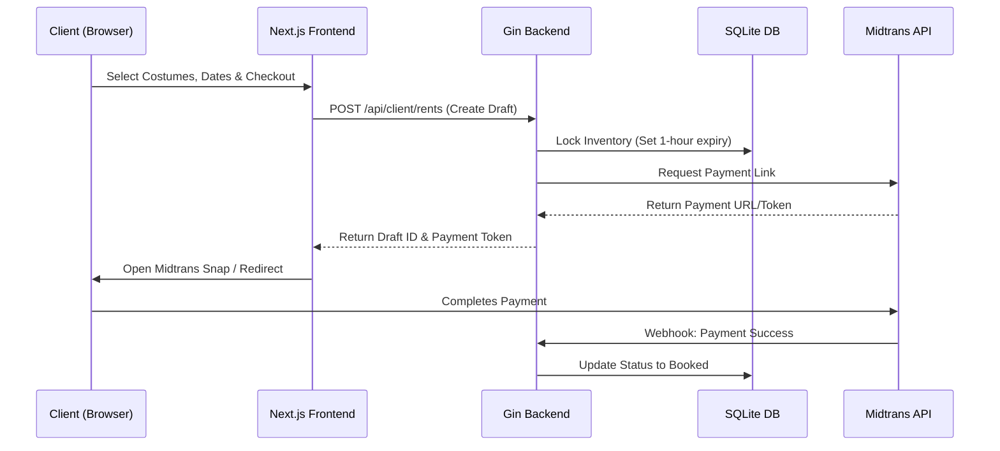
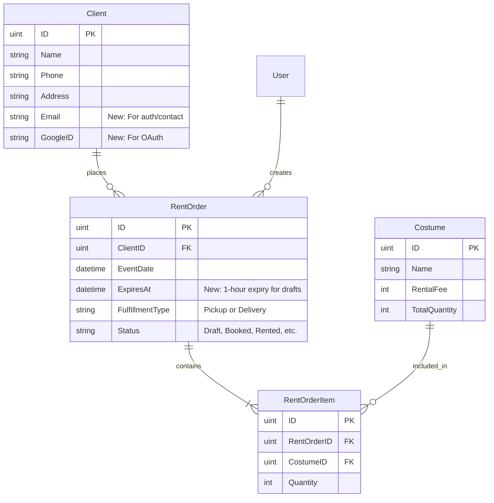

# Client Marketplace PRD

## 1. Overview
*   **Purpose:** A client-facing application marketplace for customers to browse, book, and pay for costume rentals online.
*   **Problem Solved:** Currently, clients rely on manual staff entry (POS) or offline visits. This app empowers clients to self-serve their costume rentals and guarantee stock availability without staff intervention.
*   **Primary Goal:** To provide a seamless, self-serve booking and payment experience for costume rentals, expanding the business's reach and reducing staff operational load.

## 2. Requirements
*   **Accessibility/Platform:** Responsive Web Application (Mobile-first design).
*   **Users:** Customers/Clients.
*   **Data Input:** Users will input their rental dates, preferred delivery method, and payment details via Midtrans.
*   **Data Specificity:** Precise booking dates (Event Date, Pickup Date, Return Date), delivery address (if applicable), and Midtrans transaction status.
*   **Notifications/Alerts:** Payment success/failure alerts, 1-hour booking expiration warnings on the UI.

## 3. Core Features
*   **Authentication:** Hybrid Login (Google/Gmail OAuth and Email/Password) for seamless customer onboarding.
*   **Costume Catalogue & Discovery:** Browse available costumes, view details, and check date-based availability.
*   **Cart & Checkout (Cashier):** Add available costumes to cart, select rental dates.
*   **Fulfillment Options:** Optional choice of "Store Pickup" or "Delivery" (flat rate/manual arrangement for MVP).
*   **Temporary Stock Lock:** Stock is locked for 1 hour upon checkout creation. If unpaid within the time limit, the order and payment link automatically expire and stock is released.
*   **Payment Integration:** Seamless payment gateway via Midtrans for handling transactions securely.

## 4. Out of Scope
*   Advanced AI Costume Recommendations.
*   Complex User Profiles (simple account history and basic details only).
*   Dynamic shipping rate calculation via third-party APIs (deferred to future version).

## 5. User Flow
1. **Discovery/Monitoring:** Client browses the catalogue and selects a costume and rental dates.
2. **Login/Access:** Client logs in using Google OAuth or Email/Password before proceeding to checkout.
3. **Action/Setup:** Client reviews the cart, selects fulfillment (Pickup vs Delivery), and confirms the order.
4. **Core Transaction:** Client is redirected to Midtrans (or uses Snap popup) to complete the payment within the 1-hour stock lock window.
5. **Verification/Conclusion:** Client is redirected back to the success page; backend webhook verifies payment, and the order is marked as Booked.

## 6. Non-Functional Requirements
*   **Performance:** Fast initial load and SEO optimization through Next.js server-side rendering (SSR) / static generation where applicable.
*   **Scalability:** Stateless frontend architecture capable of scaling effortlessly on Vercel or similar edge networks.
*   **Security:** Secure session management (HttpOnly cookies), CSRF protection, and secure cryptographic webhook signature validation for Midtrans.

## 7. Architecture

## 8. Database Schema

> [!NOTE]  
> Utilizes the existing backend database schema with minor extensions required to support client user authentication and temporary stock locking.

| Table | Purpose |
| :--- | :--- |
| `Client` | Customer profiles, extended to support authentication (Email, GoogleID). |
| `Costume` | Master inventory list detailing rental fee, size, quantity. |
| `RentOrder` | The core rental event tracking specific dates. Extended to track 1-hour expiration and fulfillment type. |
| `RentOrderItem` | The specific costumes and their quantities attached to a parent `RentOrder`. |

## 9. API Endpoints
*Existing backend API will be expanded to support restricted client-facing actions.*

| Method | Endpoint | Purpose |
| :--- | :--- | :--- |
| `GET` | `/api/client/costumes` | Fetch available costumes (optimized for public catalogue, hides internal metrics). |
| `POST` | `/api/client/rents` | Create a draft order with a 1-hour expiration lock and generate Midtrans URL. |
| `POST` | `/api/client/webhooks/midtrans` | Midtrans webhook receiver to confirm payment and finalize booking securely. |
| `GET` | `/api/client/rents` | Fetch the logged-in client's personal order history. |
| `POST` | `/api/client/auth/session` | Sync NextAuth session with the Go backend to issue or verify JWTs. |

## 10. Design & Technical Constraints
*   **High-Level Technology:** Next.js (App Router), Tailwind CSS, shadcn/ui.
    *   *Why:* Next.js provides excellent SEO and routing. **shadcn/ui** is selected for this specific frontend to provide raw, highly customizable components that are optimal for AI-assisted development, allowing granular control over the client UI.
*   **Authentication Strategy:** **NextAuth.js (Auth.js)** is highly recommended for maximizing security compliance. It manages the complex OAuth 2.0 PKCE flow, CSRF protection, and HttpOnly cookies natively, which significantly reduces the attack surface compared to rolling a custom OAuth implementation directly in the Go backend. The Go backend will simply trust and verify the tokens issued.
*   **Design & UI/UX:** Clean, modern, mobile-first design leveraging shadcn/ui defaults, customizable to your brand colors.
*   **Typography Rules:**
    *   Sans: `Geist Mono, ui-monospace, monospace`
    *   Serif: `serif`
    *   Mono: `JetBrains Mono, monospace`

## 11. Deployment Strategy
*   **Frontend (Next.js):** Deployed to Vercel for optimal edge caching, automatic CI/CD, and fast global delivery.
*   **Backend (Go/Gin):** Existing backend infrastructure (e.g., Railway/VPS). Database migrations will be applied to SQLite.

## 12. Testing Strategy & QA
*   **Unit/Integration:** Jest / React Testing Library for core component logic.
*   **E2E (Critical Paths):** Playwright or Cypress tests to automate the checkout flow, ensuring the 1-hour lock and Midtrans redirect trigger correctly.

## 13. Localization & Internationalization (i18n)
*   **Language:** Indonesian (ID) primarily, with English (EN) fallbacks if needed.
*   **Currency:** IDR (Rupiah) via Midtrans.
*   **Timezone:** UTC for database storage, local display (WIB/WITA/WIT) for the 1-hour countdown timer on the frontend.

## 14. Third-Party Integrations
*   **Midtrans:** Payment Gateway (Snap API for frontend checkout UI, Webhooks for backend fulfillment confirmation).
*   **Google OAuth:** Provided via Google Cloud Console / NextAuth for Hybrid login.

## 15. Data Privacy, Security & Compliance
*   **Authentication:** NextAuth.js utilizing secure, encrypted HttpOnly cookies to prevent XSS attacks on session tokens.
*   **Payment Data:** PCI-DSS compliance is outsourced entirely to Midtrans; no credit card data is stored or touches our servers.
*   **Data Protection:** Client PII (Email, Phone, Address) must be protected and accessed only over HTTPS.

## 16. Success Metrics (KPIs)
*   Successful end-to-end booking rate > 80% without staff intervention.
*   Checkout abandonment rate < 30%.
*   Time-to-Interactive (TTI) < 3 seconds on mobile devices.
