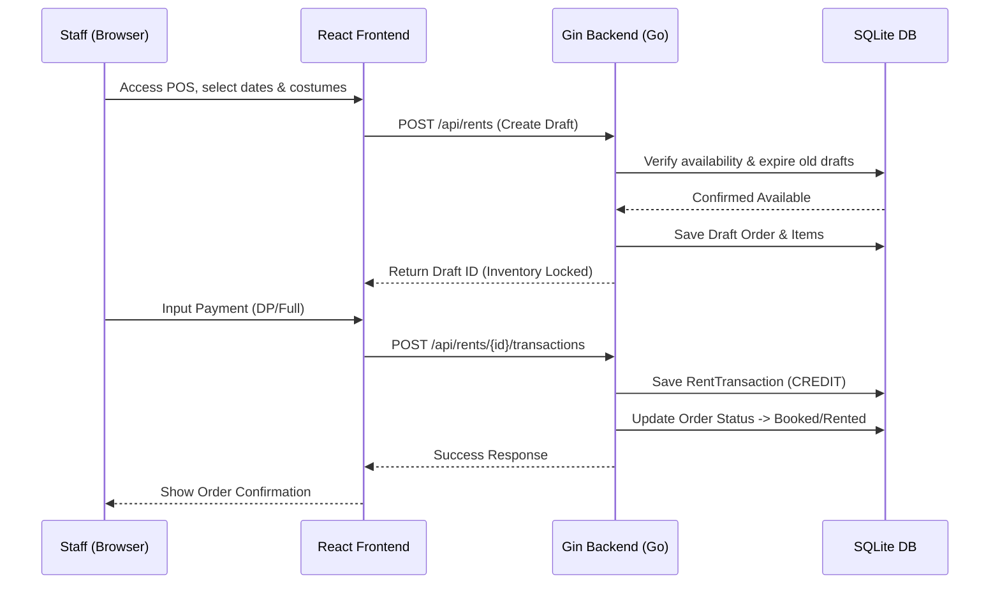
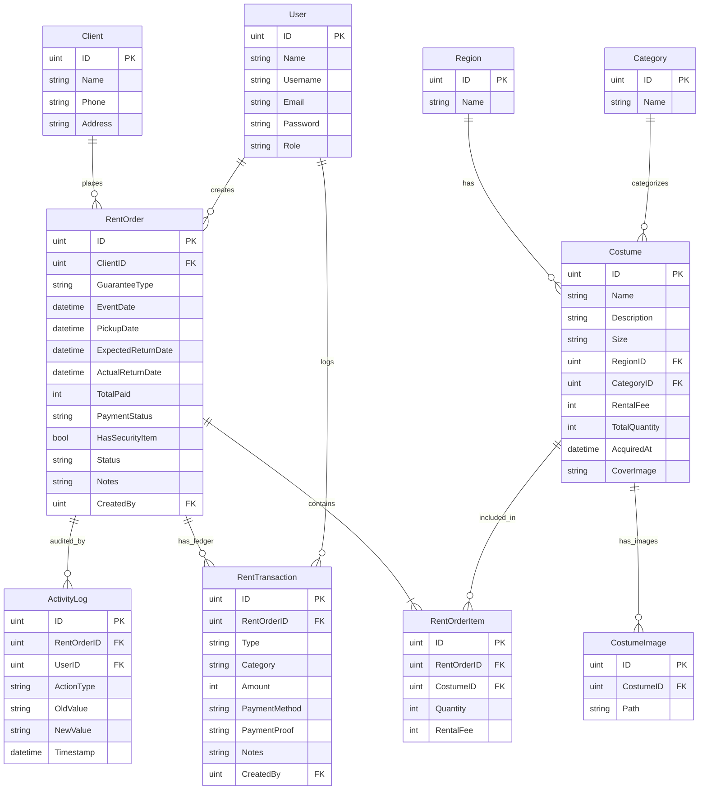

# Costume Rental System - Product Requirements Document (PRD)

## 1. Overview
*   **Purpose:** A digital point-of-sale (POS) and inventory management system designed specifically for costume rental businesses.
*   **Problem Solved:** Replaces error-prone manual spreadsheet tracking and unrecorded transactions. It prevents double-bookings through draft locking and ensures accurate, verifiable fee collection.
*   **Primary Goal:** To streamline walk-in rentals for staff, securely lock inventory for future dates, and accurately monitor the entire rental lifecycle from initial booking to final return.

## 2. Requirements
*   **Accessibility/Platform:** Web Browser (Desktop optimized for POS, but responsive for general management).
*   **Users:** Internal Staff and Managers.
*   **Data Input:** Staff manual entry via the POS interface for walk-in clients, catalogue management, and processing rental returns.
*   **Data Specificity:** Precise tracking of transaction ledgers (payments, damages, late fees), client details, event/pickup dates, and overall order statuses.
*   **Notifications/Alerts:** In-app visual indicators on the Dashboard and Calendar for overdue rentals and impending pickups.

## 3. Core Features
*   **Point-of-Sale (POS):** Cart creation, real-time availability checking, draft order locking, and checkout processing.
*   **Catalogue Management:** Creating and updating costumes, pricing, categories, and inventory quantities.
*   **Calendar Monitoring:** Visual, date-based overview of upcoming pickups and expected returns.
*   **Rent Tracking:** Monitoring and advancing the lifecycle of an order (`draft` -> `booked` -> `rented` -> `returned`/`cancelled`).
*   **Accounting Ledger:** Robust transaction-based financial tracking (using the `RentTransaction` system) for precise debit/credit handling of downpayments, final payments, late fees, and damage fees.
*   **Client Management:** Storing contact information, ID details, and tracking historical client behavior.

## 4. Out of Scope
*   Client-facing self-service portal (Planned for post-v1).
*   Online Payment Gateways (e.g., Stripe, Midtrans integration).
*   Automated SMS/WhatsApp/Email reminders for customers.
*   Delivery/Courier integrations and tracking.
*   Complex item-by-item status tracking (e.g., handling partial returns where some items in an order are returned while others are kept late).

## 5. User Flow (Rent System)
1. **Date & Costume Selection:** Staff inputs the requested rental dates, then browses and selects available costumes to add to the cart.
2. **Cart Customization (Checkout Form):** Inside the checkout form, staff can manually override and modify the rental fee and quantity for each specific costume.
3. **Client Assignment:** Staff selects an existing client from the database, or creates/adds a new client directly from the checkout form if they do not exist.
4. **Payment & Status Generation:** 
    *   Staff can choose to process a Down Payment (DP - 50% of total) or a Full Payment (100%).
    *   If **no payment** is processed at checkout, the system generates the order with a `draft` status.
    *   If **a payment** is processed, the system logs the transaction and sets the order to a `booked` status.
5. **Return & Conclusion:** After the event, the client returns the costumes. Staff inspects them, logs any damage or late fees as new transactions, collects the final balance, and marks the order as `returned` to release the inventory.

## 6. Non-Functional Requirements
*   **Performance:** Availability queries must be highly optimized. Lazy expiration of old drafts must occur silently during read operations to prevent blocking the checkout flow.
*   **Scalability:** The SQLite database is highly performant and sufficient for a single-store MVP. The GORM abstraction layer allows for seamless migration to PostgreSQL if multi-store scaling is required later.
*   **Security:** Role-based access via JWT (JSON Web Tokens) to differentiate Staff vs. Admin privileges. All critical actions must generate an immutable `ActivityLog`.
*   **Accessibility:** The UI must be designed with high contrast and clear, distinct typography suitable for fast-paced, potentially low-light retail environments.

## 7. Architecture

## 8. Database Schema

| Table | Purpose |
| :--- | :--- |
| `User` | Internal staff/admin accounts with authentication credentials and roles. |
| `Client` | Customer profiles (Name, Phone, Address). |
| `Costume` | Master inventory list detailing rental fee, size, quantity, region, category, and images. |
| `Region` / `Category` | Lookups for categorizing costumes by style or region. |
| `CostumeImage` | Stores multiple image paths for a single costume. |
| `RentOrder` | The core rental event tracking specific dates, statuses, guarantee types, and the creator/client. |
| `RentOrderItem` | The specific costumes and their quantities attached to a parent `RentOrder`. |
| `RentTransaction` | The accounting ledger tracking all financial exchanges (payments, fees) and methods/proofs. |
| `ActivityLog` | Immutable audit trail of status changes or modifications (old/new values) performed by users. |

## 9. API Endpoints

| Method | Endpoint | Purpose |
| :--- | :--- | :--- |
| `GET` | `/api/costumes` | Fetch catalogue, with optional date parameters to filter for availability. |
| `POST` | `/api/rents` | Create a new `draft` order (temporarily locking inventory). |
| `PUT` | `/api/rents/:id/status` | Advance the order state (`draft` -> `booked` -> `rented` -> `returned`). |
| `POST` | `/api/rents/:id/transactions` | Log a payment, late fee, or damage fee to the order's ledger. |
| `GET` | `/api/rents` | Fetch all orders for the Dashboard, POS, or Rent History views. |
| `GET` | `/api/stats/dashboard` | Fetch high-level KPIs and upcoming events for the calendar. |

## 10. Design & Technical Constraints
*   **High-Level Technology:** 
    *   **Frontend:** React, Vite, Tailwind CSS, HeroUI v3.
    *   **Backend:** Go (1.25), Gin Web Framework, GORM, SQLite.
    *   **Why:** This stack provides extreme speed, compile-time safety, and minimal operational overhead on the backend via Go and SQLite. The frontend leverages modern component libraries (HeroUI) for rapid, beautiful UI development without re-inventing basic accessible components.
*   **Typography Rules:** 
    *   Sans: `Geist Mono, ui-monospace, monospace`
    *   Serif: `serif`
    *   Mono: `JetBrains Mono, monospace`

## 11. Deployment Strategy
*   **Hosting Infrastructure:** Self-hosted on a local STB (AML S905X box).
*   **CI/CD Pipeline:** A self-hosted GitHub Actions runner on the STB triggers automatically on every push to the `main` branch.
*   **Containerization:** Docker with BuildKit caching is used to containerize both the frontend and backend efficiently.
*   **Networking & Exposure:** The application is securely exposed to the public internet using a Cloudflare Tunnel (`cloudflared`) mapped to port 80.

## 12. Testing Strategy & QA
*   **Methodology:** Strict Test-Driven Development (TDD) is enforced going forward. 
*   **Coverage:** All new features, core backend business logic (like ledger calculations), and critical frontend components must be built test-first.

## 13. Localization & Internationalization (i18n)
*   **Currency:** Strictly Indonesian Rupiah (IDR). No multi-currency abstractions are needed.
*   **Timezones:** The system must handle dates relative to local Indonesian time (WIB/GMT+7), ensuring calendar days map correctly for walk-in rentals.

## 14. Third-Party Integrations
*   **External Services:** None. Online payment gateways (Stripe/Midtrans) and external notifications (SMS/Email) are explicitly out of scope for V1.

## 15. Data Privacy, Security & Compliance
*   **Security Posture:** Standard Role-based access control via JWT is sufficient for internal staff operations. No advanced PII encryption (beyond standard password hashing) or strict regional compliance (like GDPR) is required for this MVP phase.

## 16. Success Metrics (KPIs)
*   **Performance:** Standard metrics for an administrative dashboard. The system must maintain fast, sub-second load times for the POS cart, responsive catalog queries, and ensure background tasks (like draft expirations) do not block the user interface.